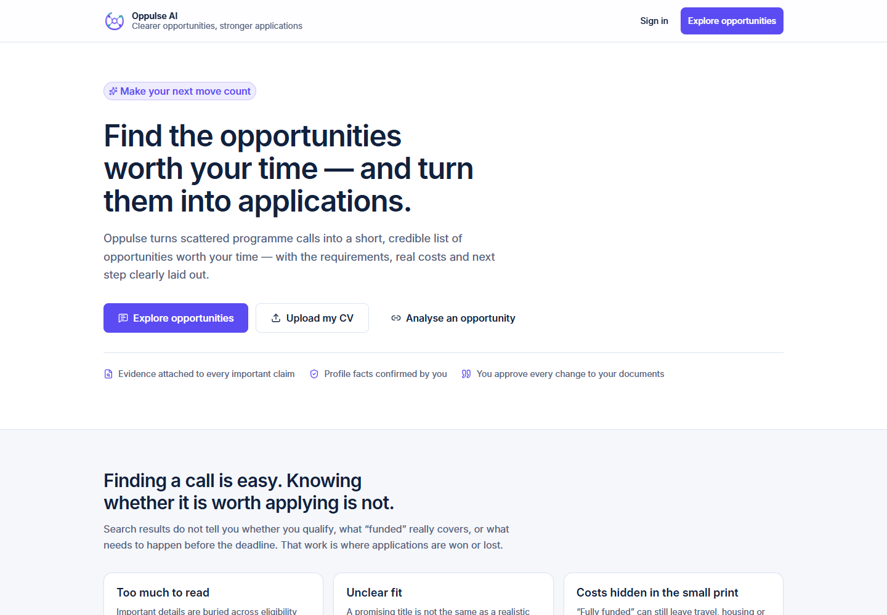
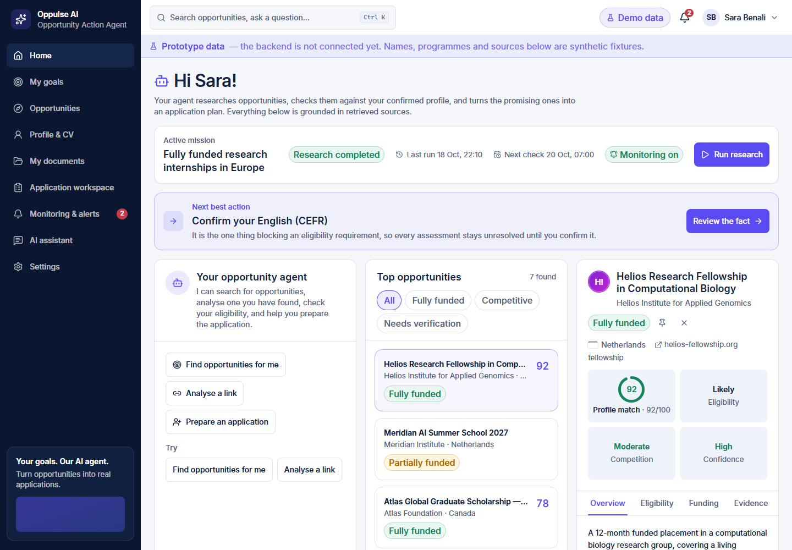
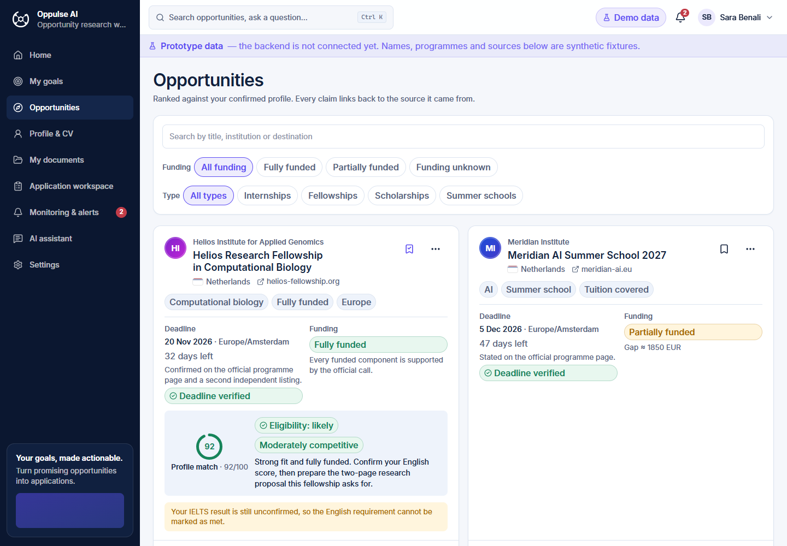
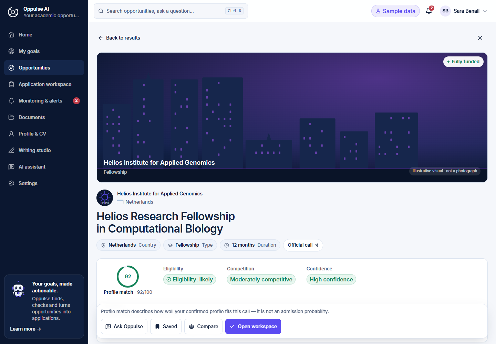
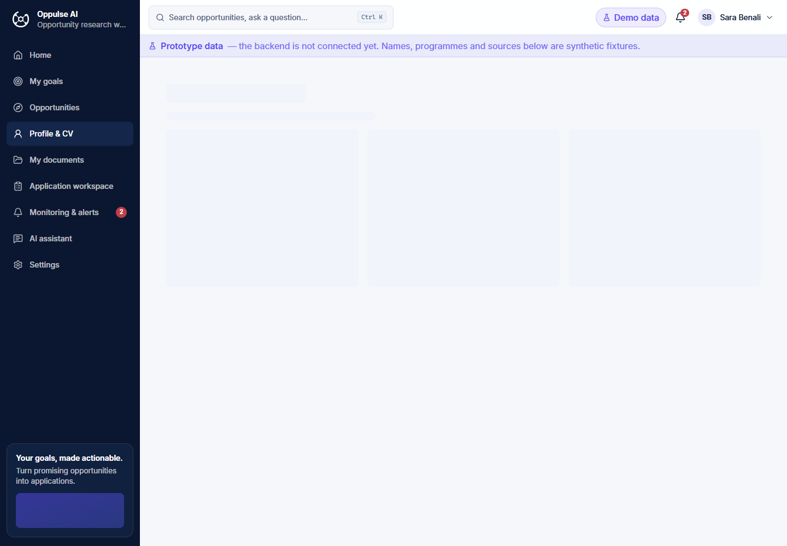
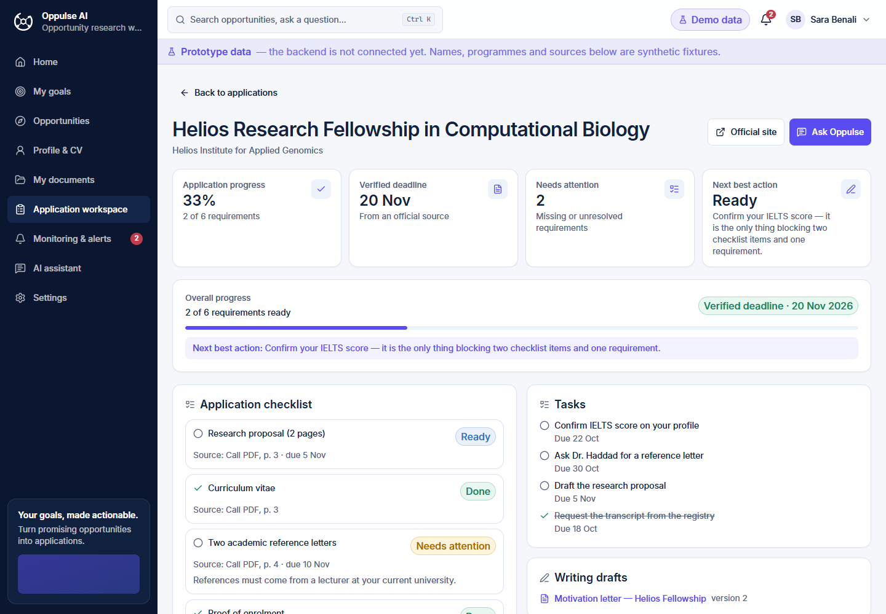
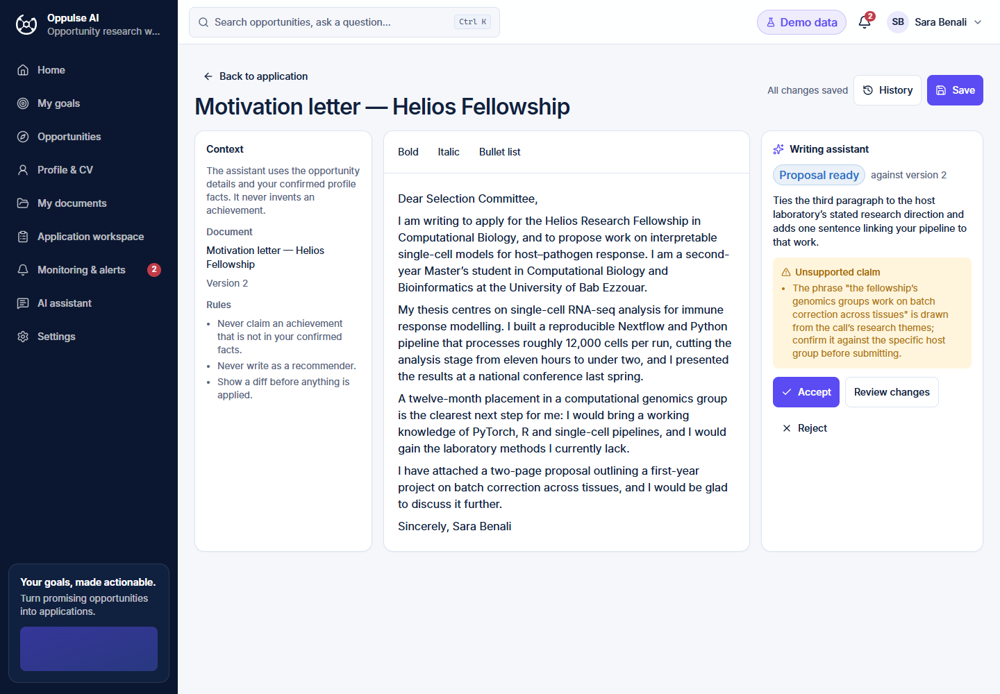
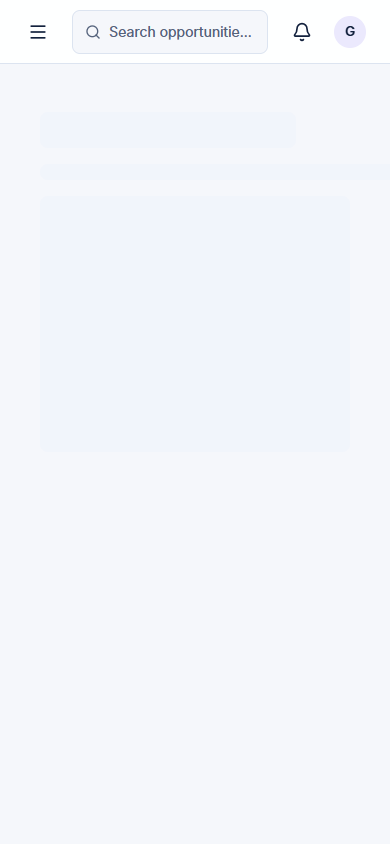

# Oppulse AI

**Find the right opportunity. Understand the requirements. Prepare with confidence.**

Oppulse AI is a student opportunity workspace that combines AI-assisted research, structured programme analysis, and application preparation tools — helping students move from scattered information to a focused, evidence-backed plan.

> Discover → Evaluate → Understand → Prepare → Apply

Developed as part of the **ThirdUni Program, Cohort 1 (October 2026)**.

---

## The problem

Finding an opportunity is only the beginning.

Students searching for scholarships, research internships, fellowships, and graduate programmes still have to answer difficult questions on their own:

- Am I academically eligible?
- Does the programme accept my degree and field of study?
- Is it fully funded, partially funded, or self-funded?
- What language qualifications and documents are required?
- Which deadline applies to my situation?
- What should I prepare next?

The answers are scattered across programme websites, application portals, PDFs, and FAQs — often inconsistent, sometimes missing entirely. Missing one requirement, or misreading a funding condition, can mean losing an opportunity.

---

## The solution

Oppulse AI is not another scholarship listing site. It brings AI-assisted research, student profile context, structured opportunity information, and application preparation tools into one workspace.

**What Oppulse brings together:**

| Feature | Description |
|---|---|
| Personalized opportunity discovery | Students describe their goals, field, destination preferences, and funding needs. The system uses this context to guide research rather than return generic lists. |
| Opportunity analysis | Programme information is organized into practical details: eligibility, academic requirements, language qualifications, required documents, deadlines, funding, and application procedures. |
| Source-aware information | Important claims stay connected to their original sources. Missing, conflicting, or unverified information is identified — not presented as confirmed fact. |
| Student profile and CV | A dedicated profile provides academic context for opportunity evaluation. Students control their information and review AI-suggested facts before they are confirmed. |
| Application preparation | Students can organize requirements, track progress, and work on application materials in a dedicated workspace. |
| Contextual AI assistant | The assistant helps students understand opportunities, clarify requirements, and decide what to do next — while retaining the context of their goals and selected opportunities. |

The goal is not to make admission decisions on behalf of students. It is to help them make better-informed decisions and prepare more effectively.

---

## How it works

1. **Build your profile** — Add academic information, interests, goals, and relevant documents.
2. **Describe your objective** — Explain what you are looking for or provide a programme link.
3. **Research opportunities** — Use the available search and AI integrations to investigate relevant programmes and their official sources.
4. **Evaluate the details** — Review eligibility, funding, deadlines, requirements, and unresolved information.
5. **Prepare your application** — Organize documents, tasks, and application materials.
6. **Stay organized** — Track application progress and relevant updates.

---

## Product screenshots

The following screenshots show the current student-testing interface. They use deterministic replay data and should not be interpreted as proof that every displayed opportunity or external integration is live.

| | |
|---|---|
|  |  |
| Landing page | Home workspace |
|  |  |
| Opportunity explorer | Opportunity analysis |
|  |  |
| Profile and CV | Application workspace |
|  |  |
| Writing studio | Mobile view |

---

## Technology

| Layer | Technologies |
|---|---|
| Frontend | React, TypeScript, Vite |
| Styling | Tailwind CSS |
| Backend | Python, FastAPI |
| Database | SQLAlchemy, Alembic · SQLite (local) · Supabase Postgres (production) |
| AI | Groq API, structured model outputs |
| Web research | Tavily integration with a search-provider adapter |
| Frontend testing | Vitest, MSW, Playwright |
| Backend testing | Pytest |
| Deployment | Vercel (frontend) · Azure App Service (backend) · configuration ready, resources not provisioned |

---

## Architecture

```
React + Vite + TypeScript
        │
        │  one typed HTTP client · one contract
        ▼
FastAPI + SQLAlchemy + Alembic
        │
        ├── deterministic rules and ownership checks
        ├── Groq structured-output model adapter
        ├── Tavily / Exa search adapters
        ├── private local or Supabase document storage
        └── configurable HTTP email adapter
```

The frontend uses the same HTTP contract in every mode:

| Mode | How it works |
|---|---|
| **Mock** | MSW serves deterministic synthetic fixtures in the browser — no backend needed. |
| **Replay** | The backend runs the full agent loop without network calls or provider keys. |
| **Live** | The frontend calls the FastAPI service; the service calls only configured providers. |

Switching from mock to live requires only two environment variables — no component rewrites:

```env
VITE_API_MODE=live
VITE_API_BASE_URL=http://localhost:8000
```

---

## Implementation status

| Area | Status |
|---|---|
| Public landing page and responsive UI | ✅ Complete |
| Onboarding and mission creation | ✅ Complete |
| Profile, CV and document consent flows | ✅ Complete |
| Deterministic eligibility and next-action rules | ✅ Complete |
| Opportunities, evidence and institution identity | ✅ Complete |
| Application workspace and writing proposals | ✅ Complete |
| Monitoring and in-app alerts | ✅ Complete |
| FastAPI endpoint mirror | ✅ Complete |
| Auth, rotating sessions and ownership checks | ✅ Complete |
| Durable document storage seam | ✅ Complete |
| Alembic migration and production startup path | ✅ Complete |
| Replay / mock mode without provider credentials | ✅ Complete |
| Groq model and Tavily web-search adapters | ✅ Validated locally with live credentials (31 October 2026) |
| Supabase Postgres and private Storage | 🔑 Ready — awaiting provisioning |
| Email delivery adapter | 🔑 Ready — awaiting provider configuration |
| Azure deployment | 📋 Runbook ready — resources not provisioned |

"Complete" means implemented and covered by the repository's tests. Live provider and cloud rows require external accounts, credentials, and environment-specific provisioning.

---

## Run locally

### Prerequisites

- Node.js 18+
- Python 3.12+ with [`uv`](https://docs.astral.sh/uv/)

### Frontend

```powershell
cd frontend
npm ci
Copy-Item .env.example .env.local
npm run dev
```

Open [http://localhost:5173](http://localhost:5173). The default configuration uses deterministic mock data — no backend or provider keys required.

To connect to the local FastAPI backend instead, add to `frontend/.env.local`:

```env
VITE_API_MODE=live
VITE_API_BASE_URL=http://localhost:8000
VITE_PRODUCT_MODE=student_testing
VITE_SHOW_PROTOTYPE_BANNER=false
```

### Backend

```powershell
cd backend
uv sync --all-extras
uv run alembic upgrade head
uv run uvicorn app.main:app --reload --port 8000
```

Replay mode requires no provider keys:

```env
OPPULSE_ENVIRONMENT=local
OPPULSE_MODEL_PROVIDER=replay
OPPULSE_SEARCH_PROVIDER=replay
```

### Validation

```powershell
# Frontend
cd frontend
npm run typecheck
npm run format:check
npm run test -- --run
npm run build

# Backend
cd backend
uv run pytest
uv run ruff check .
uv run ruff format --check .
uv run mypy app
uv run python scripts/check_contract.py
```

---

## Environment variables

**Frontend** — public settings only, safe in `VITE_` prefix:

```env
VITE_API_MODE=mock|live
VITE_API_BASE_URL=https://your-api-host
VITE_PRODUCT_MODE=demo|student_testing
VITE_SHOW_PROTOTYPE_BANNER=false
```

**Backend** — provider keys and credentials, server-side only:

```env
OPPULSE_DATABASE_URL=...
OPPULSE_JWT_SECRET=...
OPPULSE_MODEL_PROVIDER_KEY=...
OPPULSE_SEARCH_PROVIDER_KEY=...
OPPULSE_SUPABASE_URL=...
OPPULSE_SUPABASE_SERVICE_ROLE_KEY=...
OPPULSE_EMAIL_PROVIDER_URL=...
OPPULSE_EMAIL_PROVIDER_KEY=...
```

> **Never commit `.env`, `.env.local`, database files, service-role keys, provider keys, or signed URLs.** Use Azure App Service settings or Key Vault for deployed environments.

See [`docs/environments.md`](docs/environments.md) for boundary rules and [`docs/azure-runbook.md`](docs/azure-runbook.md) for the full deployment sequence.

---

## Repository structure

```
Oppulse AI/
├── frontend/               React + TypeScript application
│   ├── src/                Components, features, typed API client, tests
│   ├── e2e/                Playwright end-to-end tests
│   ├── public/brand/       Logo and brand assets
│   └── docs/screenshots/   Product journey evidence
├── backend/                FastAPI service
│   ├── app/api/            Route handlers
│   ├── app/ai/             Provider adapters and agent stages
│   ├── app/db/             SQLAlchemy models and session
│   └── migrations/         Alembic migrations
├── contracts/              Shared frontend/backend API contract
└── docs/                   Architecture, environment and deployment docs
```

---

## Deployment

The deployment path is deliberately explicit to avoid silent misconfigurations:

1. Provision separate staging resources (Supabase project, Azure App Service, storage bucket).
2. Configure the database and private document storage.
3. Run Alembic migrations before serving traffic.
4. Set exact CORS origins and configure secure cookies.
5. Add provider keys through Azure Key Vault or App Service settings.
6. Run provider smoke tests.
7. Verify `/health`, `/health/ready`, and `/api/v1/capabilities`.
8. Run the synthetic student journey end to end.
9. Only then invite students to staging.

The repository does not provision cloud, search, or model accounts automatically — those are intentional external deployment inputs.

---

## What happens next

The immediate priorities are live provider activation (Groq structured outputs and Tavily web research), Supabase Postgres provisioning for durable student data, and the first real student cohort onboarding. After that: expanded opportunity coverage across more regions and programme types, improved eligibility matching as more student profiles are added, and a mobile-first flow for students using phones as their primary device.

---

## ThirdUni Program

Oppulse AI is developed as part of the **ThirdUni Program**, with the goal of making academic opportunity discovery more transparent, more practical, and more useful for students in Algeria and the wider region. The project combines product design, evidence-aware AI workflows, deterministic decision logic, and a deployable full-stack foundation.

---

## Responsible development

Oppulse AI is designed with the following principles:

- Unconfirmed facts do not decide eligibility.
- Protected personal details are kept outside model prompts.
- Uploaded documents are private and ownership-checked.
- Provider failures are explicit states — never silent empty results.
- Simulated, live, and unavailable capabilities are disclosed separately.
- The system never sends an application or external message without student confirmation.
- Source conflicts and unreachable pages remain visible rather than suppressed.
