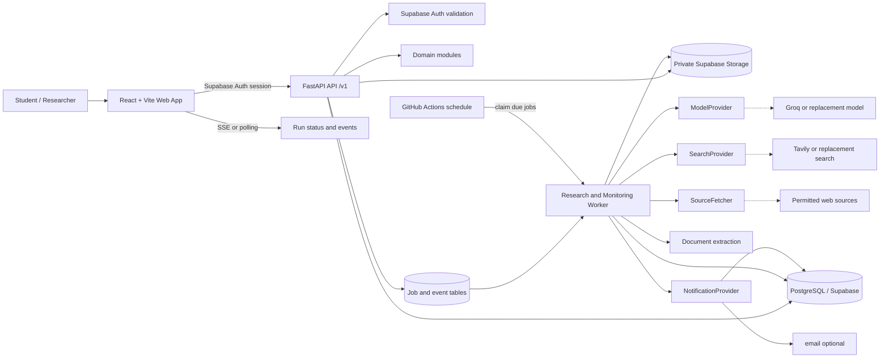
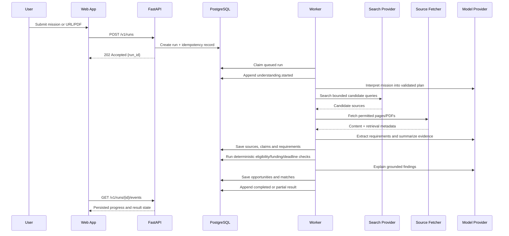
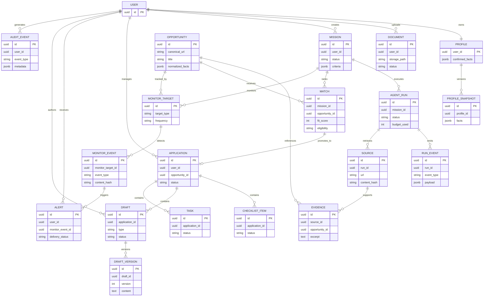
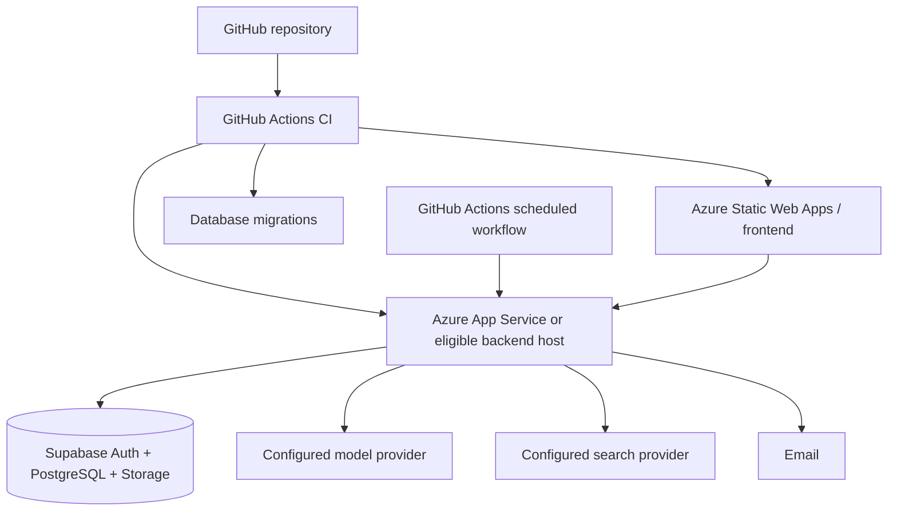

# Oppulse AI — Technical Stack and Architecture

**Product:** Oppulse AI — Opportunity Action Agent  
**Document status:** Architecture draft  
**Audience:** Product, engineering, demo and deployment teams  
**Source of truth:** Consolidated from the Oppulse AI foundational product blueprint, technical plan and comprehensive product requirements.

---

## 1. Executive Summary

Oppulse AI is a personal, evidence-backed opportunity agent for students and researchers. It helps a user move through the complete journey:

> **Discover → Understand → Verify → Prepare → Apply → Monitor**

The first release must prove one complete vertical slice rather than present a collection of simulated features:

1. Sign in to a private workspace.
2. Upload a CV or supporting document.
3. Review and confirm extracted profile facts.
4. Describe a research mission in natural language.
5. Run an actual, bounded web-research workflow.
6. Produce ranked opportunities with citations, eligibility reasoning, funding coverage and uncertainties.
7. Save an opportunity into an application workspace.
8. Create and revise an application document without destructive automatic overwrites.
9. Save the mission for monitoring.
10. Detect a controlled source change and deliver an in-app or email alert.

The recommended architecture is a **modular monolith with asynchronous, database-backed job execution**. The frontend, API and worker are independently deployable runtime components, but the domain is not prematurely split into microservices. The design keeps clear module boundaries and provider adapters so individual components can be extracted later if scale or team structure justifies it.

The AI is an orchestrated tool caller, not the system of record. AI interprets goals, extracts nuanced requirements, compares evidence and drafts explanations. Ordinary application code owns authorization, persistence, deterministic calculations, scheduling, duplicate detection, state transitions and notification delivery.

---

## 2. Architecture Goals and Constraints

### 2.1 Functional goals

- Support conversational onboarding and adaptive mission creation.
- Process user-provided CVs, transcripts, certificates and other supported files.
- Accept a pasted opportunity URL or uploaded announcement PDF as an independent entry point.
- Search supported web sources and retrieve official pages and documents.
- Produce source-backed opportunity analyses.
- Separate fit, eligibility, funding, competitiveness and confidence.
- Maintain an editable application workspace with checklists, drafts and task state.
- Provide a reviewable writing assistant with version history.
- Monitor saved missions or opportunities on a schedule and create actionable alerts.
- Preserve execution history and honestly expose failed or inaccessible sources.

### 2.2 Non-functional goals

| Area | Target for the first release |
|---|---|
| Correctness | No eligibility, funding or deadline claim is shown as verified without stored evidence. |
| Security | Every user-owned resource is authorization-checked; private documents are never public. |
| Resilience | A browser refresh does not lose a research run; transient provider failures are retried and recorded. |
| Explainability | Each important assessment links to source evidence and relevant profile facts. |
| Cost | Prefer free tiers and Azure for Students resources; no paid service or subscription upgrade without explicit approval. |
| Operability | Bounded agent runs, explicit progress events, structured logs and reproducible local setup. |
| Accessibility | Keyboard-accessible controls, readable contrast, responsive layouts and meaningful loading/error states. |
| Extensibility | Model, web-search, notification and storage providers are accessed through internal ports/adapters. |

### 2.3 Constraints and non-goals

- The system must not claim unrestricted web access or real-time monitoring.
- LinkedIn scraping is not a dependency. Initial support is manual content import, permitted identity/profile access where available, or user-provided links/text.
- Automatic application submission, sending messages and publishing content require explicit user approval and are outside the default autonomous permission set.
- The first release does not require a multi-agent swarm, vector database, Kubernetes or microservices.
- A fit score is not an admission probability. Acceptance rates and competition are shown only when supported by meaningful evidence.

---

## 3. Recommended Technology Stack

### 3.1 Selected stack

| Layer | Selection | Role |
|---|---|---|
| Web client | React + Vite + TypeScript | Fast, responsive single-page application with real routes and typed UI code. |
| UI system | Tailwind CSS + shadcn/ui or equivalent accessible primitives | Consistent Oppulse visual language, responsive layout and accessible interactions. |
| Icons and motion | Lucide React; restrained CSS transitions | Consistent iconography and meaningful state transitions. |
| Client routing | React Router | Routes for Home, Goals, Opportunities, Documents, Applications, Monitoring, Assistant and Settings. |
| Server state | TanStack Query | Caching, mutations, retries, invalidation and polling of asynchronous runs. |
| Forms and validation | React Hook Form + Zod | Typed mission, profile, document and application forms. |
| Writing editor | Tiptap | Rich text editing, selection-based AI actions, undo/redo and version-aware drafts. |
| API backend | Python + FastAPI | Versioned HTTP API, authentication integration, orchestration entry points and domain services. |
| API schemas | Pydantic | Request/response validation and structured AI/tool output validation. |
| Persistence access | SQLAlchemy 2.x or a clear typed repository layer | Transaction boundaries, migrations and domain-oriented data access. |
| Database | PostgreSQL through Supabase | Relational system of record for profiles, missions, runs, evidence, applications, drafts and alerts. |
| Authentication | Supabase Auth | Sign-up, sign-in, session/JWT issuance and account lifecycle. |
| Private files | Supabase Storage | Private buckets, ownership policies and short-lived signed URLs. |
| AI model | Provider adapter; initial candidate Groq with a tool-calling structured-output model | Mission interpretation, nuanced extraction, evidence-grounded explanations and drafting. |
| Web research | Provider adapter; initial candidate Tavily plus controlled HTTP retrieval | Search, source discovery and page retrieval within quotas and access rules. |
| Document extraction | PyMuPDF for PDF, python-docx for DOCX, safe text extraction pipeline | Local/server-side extraction before sending only necessary context to an AI provider. |
| Background execution | Database-backed job table plus a separate worker process | Resumable research runs, document processing, monitoring checks and notification retries. |
| Scheduling | GitHub Actions scheduled workflow for the zero-cost prototype; worker-native scheduler later | Triggers due monitoring jobs without relying on a browser session. |
| Notifications | In-app alerts first; Email provider as external channel | Reliable visible alerts with delivery state and retry history. |
| Testing | Pytest, API integration tests, frontend component tests, Playwright | Unit, contract, security and complete user-journey coverage. |
| CI/CD | GitHub Actions | Linting, type checks, tests, build and scheduled monitoring trigger. |
| Frontend deployment | Azure Static Web Apps Free, subject to account/quota verification | Static frontend hosting and deployment integration. |
| Backend deployment | Eligible Azure App Service Linux F1 or equivalent free-tier application host | FastAPI API and bounded worker runtime. |

### 3.2 Provider policy

Groq and Tavily are implementation candidates, not hard-coded product assumptions. Their availability, quotas, terms, model names and account requirements must be verified during setup. The code must expose interfaces such as `ModelProvider`, `SearchProvider`, `SourceFetcher` and `NotificationProvider`, allowing a replacement provider through environment configuration.

The frontend must never receive model, search, storage or notification secrets. Provider calls happen server-side, and provider errors become typed execution events rather than silently turning into empty results.

### 3.3 Why not microservices yet?

The team and product are early-stage, the domain boundaries are still being validated, and the zero-cost constraint penalizes operational overhead. A modular monolith provides:

- one deployable API codebase;
- clear domain ownership and internal interfaces;
- simple transactions for user actions;
- fewer network failure modes;
- faster implementation and testing; and
- a credible extraction path when a module develops independent scale or ownership.

The worker is a separate runtime process because long-running research and scheduled monitoring should not depend on an HTTP request or browser session. It is still part of the same bounded application system and shares the database through explicit repositories.

---

## 4. System Architecture



### 4.1 Runtime components

**Web client.** Presents the workspace, starts commands, renders persisted state and subscribes to actual run events. It never performs privileged provider calls or makes eligibility decisions locally.

**FastAPI API.** Authenticates requests, validates inputs, enforces ownership, handles short operations and creates durable jobs for long operations. It exposes versioned contracts and maps domain errors to consistent error responses.

**Domain modules.** Encapsulate profiles, documents, missions, opportunities, applications, writing, monitoring, alerts and agent runs. Modules communicate through typed internal interfaces, not direct access to another module's tables.

**Worker.** Claims jobs using a lease, executes bounded workflows, emits progress events, writes evidence and domain results, retries transient failures and records permanent failures. A worker restart must be safe because state is persisted after each meaningful step.

**PostgreSQL.** The source of truth for structured data, execution state, evidence metadata, normalized opportunities, user feedback and notification status.

**Private storage.** Stores original uploads and generated exports. Access is mediated by ownership checks and short-lived signed URLs.

### 4.2 Agent execution flow



**Execution rule:** the model may propose tool calls, but the application validates every call, authorizes it, enforces limits and records the result. Retrieved web pages and uploaded documents are untrusted evidence and never system instructions.

### 4.3 Agent tools

Initial tools should be narrow and schema-validated:

- `search_web(query, filters)`
- `fetch_source(url)`
- `extract_uploaded_document(document_id)`
- `extract_opportunity_requirements(source_ids)`
- `compare_profile_to_requirements(profile_snapshot_id, requirements)`
- `check_eligibility(profile_snapshot_id, requirement_ids)`
- `calculate_funding_gap(funding_facts)`
- `find_similar_programs(opportunity_id or query)`
- `save_opportunity(mission_id, normalized_opportunity)`
- `create_application_checklist(opportunity_id)`
- `create_document_draft(opportunity_id, document_type)`
- `schedule_monitoring(target_id, configuration)`
- `create_alert(event_id)`

The agent has a maximum runtime, model-call count, search-call count, fetched-source count, output size and retry budget. When a limit is reached or evidence is insufficient, it returns a partial result with an explicit uncertainty state.

### 4.4 AI versus deterministic code

| Concern | Owner |
|---|---|
| Interpret a natural-language mission | AI, validated into a typed mission plan |
| Extract nuanced requirements from a call | AI plus source/page evidence |
| Explicit nationality, degree, date and document rules | Deterministic rules with evidence |
| Fit score calculation | Repeatable application rubric; AI may supply normalized features |
| Funding gap and date calculations | Deterministic code; preserve currency and source context |
| Duplicate opportunity/event detection | Normalized identifiers, hashes and database constraints |
| Tool authorization and ownership | Application code |
| Source retrieval and retry policy | Provider adapter and worker |
| Explanations and recommendations | AI grounded only in stored evidence |
| Scheduling and notifications | Worker and notification module |

---

## 5. Domain Model and Data Ownership

Each entity has one owning module. Other modules read through repository interfaces or application services rather than writing another module's tables directly.



### 5.1 Core tables

- `profiles`: user-confirmed facts, preferences and consent controls. Extracted facts are proposed first and become eligible for important decisions only after confirmation.
- `profile_snapshots`: immutable facts used for a run, so later profile edits do not rewrite historical reasoning.
- `documents`: metadata, category, processing status, storage path, extracted facts and deletion state.
- `missions`: natural-language objective plus structured criteria, source scope, monitoring configuration and status.
- `agent_runs` and `run_events`: durable execution state and user-visible progress.
- `sources` and `evidence`: retrieval metadata, source quality, excerpts, page references, timestamps and claims.
- `opportunities`: normalized canonical opportunity records; use URL/domain/program identifiers to deduplicate.
- `matches`: user- and mission-specific fit, eligibility, funding and confidence assessments with reasons.
- `applications`: the transition from a discovery to an actionable application workspace.
- `drafts` and `draft_versions`: editable content, accepted revisions and recoverable history.
- `monitor_targets`, `monitor_events` and `alerts`: scheduled checks, meaningful changes, deduplication and delivery history.
- `audit_events`: security-sensitive actions, consent changes, document access, agent tool calls and notification outcomes.

### 5.2 Consistency and idempotency

- Use UUIDs for externally visible identifiers.
- Enforce `user_id` ownership on every user-owned table.
- Use unique constraints for canonical opportunities, source snapshots, monitor events and alert fingerprints.
- Require an idempotency key for run creation, draft revision acceptance and notification delivery requests.
- Use transactions for user actions that create several related records, such as promoting an opportunity into an application workspace.
- Use leases (`claimed_at`, `claim_expires_at`, `worker_id`) for jobs so a crashed worker can be recovered.
- Use immutable evidence and run events; corrections create new records or versions rather than silently rewriting history.

---

## 6. Module Boundaries

| Module | Responsibility | Owns data | Exposes |
|---|---|---|---|
| Identity and access | Session validation, account ownership, consent and authorization context | Auth mapping, consent records | Request guards and user context |
| Profile | Confirmed academic facts, preferences and profile snapshots | `profiles`, `profile_snapshots` | Profile service and `/profile` API |
| Documents | Upload metadata, safe extraction, processing status, deletion | `documents`, document storage objects | Document service and `/documents` API |
| Missions | Natural-language goal, structured criteria, source scope and lifecycle | `missions` | Mission CRUD and run creation |
| Agent runs | Job lifecycle, budget, progress and failure state | `agent_runs`, `run_events`, jobs | Run status/events API and worker contracts |
| Research | Search, retrieval, source normalization, evidence and opportunity extraction | `sources`, `evidence`, `opportunities` | Provider ports and research application service |
| Matching | Fit rubric, eligibility states, funding coverage and confidence | `matches`, assessment details | Assessment service |
| Applications | Saved opportunities, checklist, tasks, recommendation tracking | `applications`, checklist items, tasks | Application workspace API |
| Writing | Draft editing, AI proposals, version history and exports | `drafts`, `draft_versions` | Draft and revision API |
| Monitoring | Source snapshots, checks, meaningful event classification | `monitor_targets`, `monitor_events` | Monitoring service and worker jobs |
| Notifications | In-app alerts, email delivery and retry status | `alerts`, delivery attempts | Alert API and provider port |
| Integrations | Provider connection status and minimal credentials/metadata | `integrations` | Settings API; no provider secret to client |
| Audit and observability | Security, agent and delivery audit events | `audit_events`, structured logs | Internal audit queries |

Recommended backend layout:

```text
backend/
  app/
    main.py
    api/v1/
    core/                 # config, auth, errors, logging
    modules/
      profile/
      documents/
      missions/
      agent_runs/
      research/
      matching/
      applications/
      writing/
      monitoring/
      notifications/
      integrations/
      audit/
    ports/                # model, search, fetch, notification interfaces
    adapters/             # Groq, Tavily, HTTP, email implementation
    infrastructure/       # database, storage, migrations, job claiming
  tests/
```

---

## 7. API Contracts

All endpoints are versioned under `/api/v1`. List endpoints use cursor pagination where applicable. Errors use one shape:

```json
{
  "error": {
    "code": "RESOURCE_NOT_FOUND",
    "message": "The requested resource was not found.",
    "request_id": "req_01..."
  }
}
```

### 7.1 Profile and documents

| Method | Path | Purpose |
|---|---|---|
| `GET` | `/api/v1/profile` | Return confirmed profile and consent settings. |
| `PATCH` | `/api/v1/profile` | Update confirmed facts and preferences. |
| `POST` | `/api/v1/documents` | Create an upload session and document metadata; returns a signed upload target. |
| `GET` | `/api/v1/documents` | List the user's documents with processing status. |
| `GET` | `/api/v1/documents/{id}` | Return metadata and extracted proposed facts. |
| `POST` | `/api/v1/documents/{id}/confirm` | Confirm or reject extracted facts. |
| `DELETE` | `/api/v1/documents/{id}` | Revoke metadata and private file access. |

Example upload response:

```json
{
  "data": {
    "document_id": "uuid",
    "upload_url": "short-lived-signed-url",
    "expires_at": "timestamp",
    "status": "awaiting_upload"
  }
}
```

### 7.2 Missions and runs

| Method | Path | Purpose |
|---|---|---|
| `POST` | `/api/v1/missions` | Create a mission from natural language and/or structured criteria. |
| `GET` | `/api/v1/missions` | List missions. |
| `GET` | `/api/v1/missions/{id}` | Return mission configuration and latest run. |
| `PATCH` | `/api/v1/missions/{id}` | Edit, pause, resume or delete a mission. |
| `POST` | `/api/v1/missions/{id}/runs` | Start a bounded asynchronous research run. |
| `GET` | `/api/v1/runs/{id}` | Return status, summary and failure state. |
| `GET` | `/api/v1/runs/{id}/events` | Return persisted progress events after an optional cursor. |
| `POST` | `/api/v1/runs/{id}/cancel` | Request cancellation of a queued/running run. |

`POST /missions/{id}/runs` returns `202 Accepted` with a `run_id`; it never waits for research completion.

Run states: `queued`, `running`, `waiting_for_input`, `completed`, `partial`, `failed`, `cancelled`.

### 7.3 Opportunities and applications

| Method | Path | Purpose |
|---|---|---|
| `GET` | `/api/v1/opportunities` | Paginated results with filters and sorting. |
| `GET` | `/api/v1/opportunities/{id}` | Full analysis, assessment and evidence references. |
| `POST` | `/api/v1/opportunities/analyze` | Analyze a submitted URL or uploaded document without a saved mission. |
| `POST` | `/api/v1/opportunities/{id}/save` | Bookmark an opportunity. |
| `POST` | `/api/v1/opportunities/{id}/dismiss` | Dismiss with optional feedback reason. |
| `POST` | `/api/v1/opportunities/{id}/applications` | Promote a discovery into an application workspace. |
| `GET` | `/api/v1/applications` | List application workspaces. |
| `GET` | `/api/v1/applications/{id}` | Return checklist, tasks, drafts and deadline state. |
| `PATCH` | `/api/v1/applications/{id}` | Update status, notes or user-managed dates. |

### 7.4 Writing and drafts

| Method | Path | Purpose |
|---|---|---|
| `POST` | `/api/v1/applications/{id}/drafts` | Create a draft from an opportunity and authorized profile context. |
| `GET` | `/api/v1/drafts/{id}` | Return current content and version metadata. |
| `PATCH` | `/api/v1/drafts/{id}` | Autosave user edits. |
| `POST` | `/api/v1/drafts/{id}/proposals` | Ask for a non-destructive AI revision proposal. |
| `POST` | `/api/v1/drafts/{id}/proposals/{proposal_id}/accept` | Apply a reviewed proposal as a new version. |
| `POST` | `/api/v1/drafts/{id}/proposals/{proposal_id}/reject` | Discard the proposal. |
| `GET` | `/api/v1/drafts/{id}/versions` | List recoverable versions. |
| `GET` | `/api/v1/drafts/{id}/export` | Generate an authorized download/export. |

### 7.5 Monitoring and alerts

| Method | Path | Purpose |
|---|---|---|
| `POST` | `/api/v1/monitor-targets` | Save a mission or opportunity for monitoring. |
| `GET` | `/api/v1/monitor-targets` | List monitoring targets and next check. |
| `PATCH` | `/api/v1/monitor-targets/{id}` | Pause, resume or change frequency. |
| `GET` | `/api/v1/monitor-events` | Review detected changes and evidence. |
| `GET` | `/api/v1/alerts` | List in-app alerts with delivery status. |
| `POST` | `/api/v1/alerts/{id}/read` | Mark an alert read. |
| `POST` | `/api/v1/alerts/{id}/retry` | Retry a failed external delivery when authorized. |

### 7.6 Context-aware assistant

`POST /api/v1/assistant/messages` accepts a message, route context, selected opportunity/application/draft IDs and explicitly authorized document IDs. It returns either a direct bounded response or a `run_id` for asynchronous work. The backend decides which context is permitted; the client cannot provide arbitrary storage paths or provider instructions.

---

## 8. Security and Privacy Architecture

### 8.1 Access control

- Authenticate every protected API request using the Supabase session/JWT.
- Apply ownership checks in the service layer even when PostgreSQL RLS is enabled.
- Enable RLS for user-owned tables and storage policies for private buckets.
- Never trust a client-provided `user_id`, document path, opportunity ownership claim or integration identifier.
- Use least privilege: research tools are read-only by default.
- Require explicit approval for sending messages, submitting applications, publishing content or sharing documents externally.

### 8.2 Document handling

- Accept a small, explicit set of MIME types and enforce size limits.
- Validate file signatures, not only filename extensions.
- Process files in an isolated, non-executing pipeline.
- Store originals in a private bucket and issue short-lived signed URLs only after authorization.
- Do not place full CVs or identity documents into ordinary logs.
- Send only the minimum authorized extracted context to an external model provider.
- Show which documents are used for each mission and allow exclusion, deletion and reprocessing.

### 8.3 Prompt injection and unsafe content

Web pages, PDFs and user documents are untrusted data. They may contain instructions such as “ignore previous rules” or requests for secrets. The orchestrator must:

- keep system/tool policy separate from retrieved content;
- label source text as evidence, never instructions;
- allow tools only through a server-side allowlist;
- validate tool arguments against Pydantic schemas;
- prevent source content from authorizing external actions;
- redact secrets and sensitive fields before provider calls where possible; and
- retain the evidence and tool result used for each important claim.

### 8.4 Secrets and integrations

All provider/API keys, OAuth secrets and bot tokens belong in deployment secret storage or environment configuration. They must not be committed, sent to the browser or included in prompts. OAuth integrations use minimal scopes, validated state/redirect handling and revocation/deletion paths.

### 8.5 Retention and user control

Provide document deletion, account deletion, model-processing disclosure, consent controls and audit visibility. Deleting a document must revoke storage access and mark dependent extracted facts as unavailable unless the user has separately confirmed and retained them.

---

## 9. Deployment Topology and Operations

### 9.1 Prototype deployment profile



The deployment must not depend on Azure student credits indefinitely. Verify current free-tier availability and quotas before provisioning. Use cost alerts and avoid creating paid resources or upgrading a subscription without explicit authorization.

### 9.2 Worker model

The prototype worker can run as a separate process in the backend host or as a bounded scheduled invocation. GitHub Actions can trigger due-job processing for the demonstration, but schedules may be delayed. The UI must show `last_successful_check`, `next_scheduled_check` and monitoring status; it must never imply real-time monitoring.

For a more persistent deployment, move the worker to an always-on eligible host without changing domain contracts. Do not move to a queue platform or microservice fleet until job volume, latency or team ownership demonstrates the need.

### 9.3 Observability

Every request and job receives a correlation/request ID. Log structured metadata rather than private content:

- request ID, user-safe actor ID and route;
- run/job ID and state transition;
- provider name, operation, latency and retry count;
- source domain and content hash, not full private content;
- tool name and validation outcome;
- notification delivery result; and
- error code and sanitized message.

Track operational metrics such as run completion rate, partial/failure rate by provider, source retrieval success, evidence coverage, median run time, alert delivery failure and duplicate-alert rate.

### 9.4 Failure handling

- Retry transient provider errors with exponential backoff and a maximum attempt count.
- Mark inaccessible sources explicitly; never convert retrieval failure into “no opportunities found.”
- Allow partial results when some sources succeed.
- Persist progress after each major step.
- Dead-letter exhausted jobs for inspection and manual retry.
- Return typed user-facing errors with recovery actions.

---

## 10. Testing and Quality Gates

### 10.1 Test layers

1. **Unit tests:** funding calculations, deadline/timezone handling, fit rubric, normalization, deduplication, permission policies and state transitions.
2. **Contract tests:** Pydantic schemas, provider adapters, error shapes and idempotency behavior.
3. **Integration tests:** database transactions, RLS/ownership checks, private storage access, job claiming and retry behavior.
4. **Agent evaluation tests:** fixed missions and source fixtures verifying that claims cite the correct evidence and unknowns remain unknown.
5. **Frontend tests:** mission forms, opportunity cards, evidence panels, draft proposal review and error states.
6. **Playwright journey:** sign in → upload CV → confirm facts → create mission → run research fixture → inspect evidence → create draft → accept revision → save monitor → trigger controlled change → read alert.
7. **Security tests:** cross-user resource access, malicious document content, prompt injection fixtures, secret leakage checks and unauthorized external-action attempts.

### 10.2 Definition of done

A feature is complete only when it has a working backend path, persisted state, authorization, failure handling, tests and a reproducible clean-session demonstration. A button with mocked success is not a completed feature.

### 10.3 Evidence quality gates

Before an opportunity is presented as verified:

- the source was successfully retrieved;
- the claim has an evidence record and retrieval timestamp;
- the claim's source quality is known;
- conflicting sources are surfaced;
- an unknown value is not treated as zero or false; and
- the match result records the profile snapshot used.

---

## 11. Architecture Decision Records

### ADR-001: Use a modular monolith as the initial architecture

- **Status:** Accepted
- **Context:** Oppulse AI has a small/early team, a short delivery window, a zero-cost constraint and evolving domain boundaries.
- **Decision:** Use one FastAPI codebase with strict domain modules, plus a separately runnable worker process. Communicate internally through typed services and ports.
- **Consequences:** Faster delivery, simple transactions and lower operations overhead. The team must enforce boundaries to prevent a shared-database big ball of mud.
- **Alternatives considered:** Microservices were rejected because they add deployment, networking, observability and consistency costs before independent scaling needs are proven.

### ADR-002: Use PostgreSQL as the system of record

- **Status:** Accepted
- **Context:** The domain contains related users, documents, missions, opportunities, evidence, assessments, applications and alerts, with ownership and transactional requirements.
- **Decision:** Use Supabase PostgreSQL with RLS, UUIDs, migrations and explicit repository boundaries.
- **Consequences:** Strong relational integrity and easy reporting. Flexible AI payloads use carefully bounded JSONB fields rather than replacing the relational model.
- **Alternatives considered:** A document database was rejected because cross-entity ownership, evidence relationships, deduplication and transactional application workflows are central.

### ADR-003: Keep long-running work asynchronous and durable

- **Status:** Accepted
- **Context:** Research, document processing and monitoring exceed normal request lifetimes and must survive browser refreshes.
- **Decision:** API creates database-backed jobs; a worker claims them with leases and writes progress events. The client polls or subscribes to persisted events.
- **Consequences:** Reliable resumability and inspectable execution. The prototype needs careful job claiming and scheduled triggers.
- **Alternatives considered:** In-request processing was rejected because it creates timeouts, lost work and poor failure recovery.

### ADR-004: Keep AI behind provider and tool interfaces

- **Status:** Accepted
- **Context:** Free-tier model availability, pricing, quotas and terms may change.
- **Decision:** Implement a `ModelProvider` interface with structured output and tool-calling support; keep provider adapters server-side.
- **Consequences:** Slight abstraction overhead, but provider replacement and testing with fixtures remain possible.
- **Alternatives considered:** A proprietary provider-specific agent framework was rejected as the domain architecture because it would couple persistence, permissions and execution to one vendor.

### ADR-005: Treat evidence as a first-class domain object

- **Status:** Accepted
- **Context:** Trust depends on explaining eligibility, funding and deadlines with source-backed claims.
- **Decision:** Persist sources, excerpts, page references, retrieval timestamps, hashes and claim-to-evidence links.
- **Consequences:** More storage and schema work, but better auditability, correction and evaluation.
- **Alternatives considered:** Storing only an LLM-generated summary was rejected because it cannot support reliable verification or source conflict handling.

### ADR-006: Use a reviewable writing workflow

- **Status:** Accepted
- **Context:** Application documents are consequential and must preserve the student's meaning and factual accuracy.
- **Decision:** AI returns revision proposals and diffs; the user accepts, rejects or edits them. Accepted changes become versioned drafts.
- **Consequences:** More UI and persistence work, but prevents destructive overwrites and fabricated achievements.
- **Alternatives considered:** Directly replacing document text was rejected for safety and user trust reasons.

### ADR-007: Use Supabase for auth, relational data and private storage in the prototype

- **Status:** Accepted
- **Context:** The project needs a coherent zero-cost identity, database and file architecture.
- **Decision:** Use Supabase Auth, PostgreSQL and private Storage together, with RLS and signed URLs.
- **Consequences:** Simple integration and fewer competing systems. Quotas, project pausing and provider dependence must be documented and monitored.
- **Alternatives considered:** Splitting auth, database and storage across multiple vendors was rejected because it increases configuration and security complexity without first-release value.

---

## 12. Risks and Mitigations

| Risk | Impact | Likelihood | Mitigation |
|---|---|---:|---|
| Search/model free-tier quota exhaustion | Research runs fail or become unavailable | Medium | Cache sources, bound runs, expose provider status, use adapters and fixtures for demos. |
| Provider changes model names or terms | Deployment breaks | Medium | Environment-configured adapters, startup health checks and a replacement-provider interface. |
| Prompt injection in a webpage or PDF | Data disclosure or unauthorized action | High | Treat retrieved content as untrusted evidence; allowlisted tools, schema validation and no autonomous external actions. |
| Incorrect eligibility or funding claim | Student makes a harmful decision | High | Evidence-first schema, deterministic checks, uncertainty states, source conflicts and user-facing caveats. |
| Private document exposure | Serious privacy harm | High | RLS, private buckets, signed URLs, ownership checks, size/type validation and sanitized logs. |
| Worker crash or duplicate execution | Lost runs or duplicate alerts | Medium | Leased jobs, idempotency keys, immutable run events and unique event fingerprints. |
| Scheduled workflow delay | Monitoring is not timely | Medium | Show actual check times, never promise real time, support manual check and retain failed jobs. |
| Web source blocks retrieval | Incomplete analysis | High | Record source failure honestly; support upload/paste fallback and modular source connectors. |
| Shared database becomes tightly coupled | Slower delivery and risky changes | Medium | Module-owned repositories, migration ownership, service interfaces and architecture tests. |
| LLM fabricates qualifications or recommendation letters | Misrepresentation and trust loss | High | Ground drafts in confirmed profile facts, show diffs, block unsupported claims and keep recommender control. |
| Deadline/timezone ambiguity | Missed application deadline | High | Store exact source text, timezone, verification timestamp and unresolved state; calculate remaining time only from verified data. |
| Cost unexpectedly incurred | Violates zero-cost constraint | Medium | Use free tiers first, set Azure cost alerts, prohibit paid resource creation without explicit approval. |

---

## 13. Recommended Delivery Sequence

### Phase 1 — Foundation

- Repository structure, environment configuration and CI.
- Supabase project, migrations, Auth, RLS and private storage.
- FastAPI `/api/v1` skeleton, typed errors and request IDs.
- React routes, shared design tokens and protected workspace shell.

### Phase 2 — Profile and documents

- Upload session and private file access.
- PDF/DOCX extraction with processing status.
- Proposed facts review, confirmation, correction and profile snapshots.

### Phase 3 — Research vertical slice

- Mission builder and structured mission object.
- Database-backed runs and persisted progress events.
- Search/fetch/model adapters with fixture mode.
- Evidence, opportunity normalization, fit/eligibility/funding assessment and results UI.

### Phase 4 — Application action

- Promote opportunity to application workspace.
- Checklist and task state.
- Tiptap writing studio, AI revision proposal, diff review and version history.
- Export and authorized download.

### Phase 5 — Monitoring and notifications

- Monitor targets and source snapshots.
- Hash/normalized-content change detection.
- Controlled test-source event.
- In-app alerts and optional email delivery with retry state.

### Phase 6 — Hardening and demonstration

- Cross-user access tests, prompt-injection fixtures and file-security checks.
- Provider failure and partial-result tests.
- Playwright clean-session journey.
- Deployment, README, quota disclosure and three-minute demo rehearsal.

---

## 14. Final Architecture Recommendation

Build Oppulse AI as a **React/Vite frontend plus FastAPI modular monolith, backed by Supabase PostgreSQL/Auth/Private Storage, with a separate database-backed worker for agent runs and monitoring**. Use Groq and Tavily only through replaceable provider adapters, extract documents in a controlled server-side pipeline, and persist evidence before generating explanations.

The architectural quality bar is not the number of pages or integrations. It is whether the platform can truthfully demonstrate this durable loop:

> **Upload profile → launch agent → retrieve evidence → assess fit and eligibility → prepare an application document → save the mission → detect a controlled change → deliver an alert.**

That architecture is small enough to ship under the zero-cost constraint, strong enough to support a credible technical demonstration, and structured enough to evolve toward broader opportunity categories without rebuilding the core agent engine.
